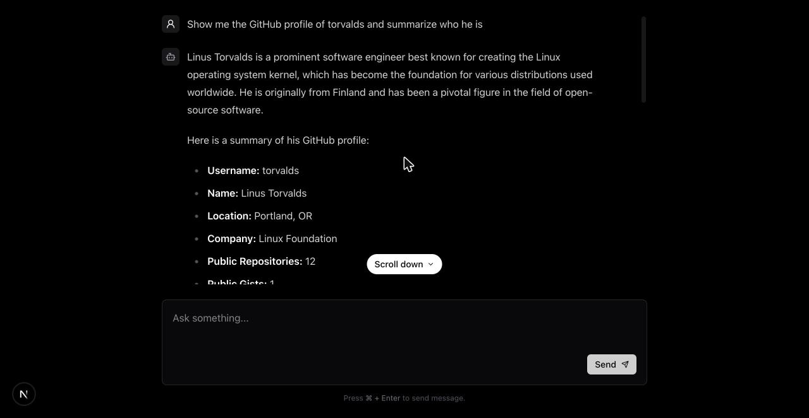
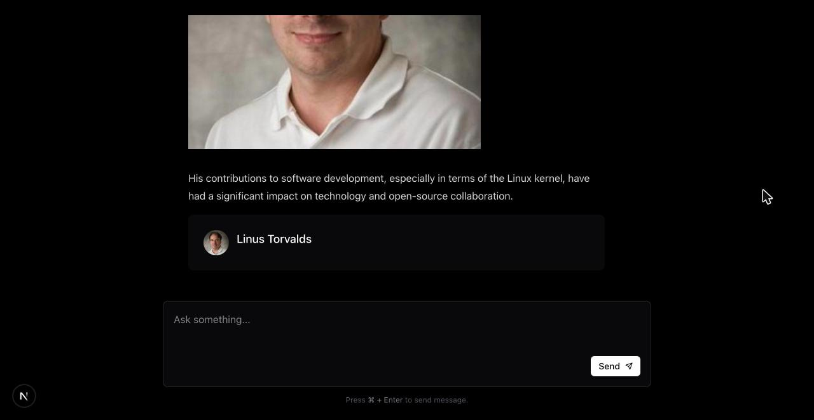

# AI SDK Chat

A streaming AI chat built with **Next.js 16** and the **Vercel AI SDK v7**. The assistant can call tools, such as looking up a GitHub profile or fetching a URL, and the UI renders each tool call as it runs: a loading state while it executes, then a custom component with the result.

Built as a study project for the Rocketseat Pós 360 program.



## Features

- **Streaming chat**: replies stream token by token through `useChat` and a UI message stream.
- **Tool calling with multiple steps**: the model can call tools and then answer with what they returned, up to 5 steps per message.
- **Tool-specific UI**: each tool part has its own loading state, result component and error display.
- **Markdown replies**: assistant messages render as GitHub-flavored Markdown with Tailwind Typography.
- **Any model through OpenRouter**: the route uses `openai/gpt-4o` by default. Switching models is a one-line change.

## Tech stack

| Area | Tools |
| --- | --- |
| ⚛️ Framework | [Next.js 16](https://nextjs.org) (App Router, Turbopack), React 19 |
| 🤖 AI | [AI SDK](https://ai-sdk.dev) (`ai`, `@ai-sdk/react`), [OpenRouter provider](https://openrouter.ai) |
| 🛠️ Tools | [Octokit](https://github.com/octokit/rest.js) for the GitHub API, [Zod](https://zod.dev) for tool input schemas |
| 🎨 UI | Tailwind CSS 4, `@tailwindcss/typography`, `tailwind-scrollbar`, `react-markdown` + `remark-gfm`, Lucide icons |
| 📘 Language | TypeScript |

## Getting started

### Prerequisites

- Node.js 20 or later
- [pnpm](https://pnpm.io)
- An [OpenRouter API key](https://openrouter.ai/keys)

### Setup

1. Install dependencies:

   ```bash
   pnpm install
   ```

2. Create a `.env.local` file in the project root:

   ```bash
   OPENROUTER_API_KEY=your-openrouter-key
   ```

3. Start the dev server:

   ```bash
   pnpm dev
   ```

4. Open [http://localhost:3000](http://localhost:3000) and ask something like *"Show me the GitHub profile of torvalds"*.

### Scripts

| Command | Description |
| --- | --- |
| `pnpm dev` | Start the development server |
| `pnpm build` | Create a production build |
| `pnpm start` | Serve the production build |
| `pnpm lint` | Run ESLint |

## How it works

```
Browser (useChat)  ──POST /api/ai──▶  Route handler (streamText)  ──▶  OpenRouter
       ▲                                  │        ▲
       │                                  ▼        │
       └──── UI message stream ◀──── tools: githubProfile, httpFetch
```

1. `src/components/chat.tsx` sends the conversation to `/api/ai` with `useChat` and a `DefaultChatTransport`.
2. `src/app/api/ai/route.ts` converts the UI messages to model messages and calls `streamText` with the tool set.
3. When the model calls a tool, the AI SDK runs it on the server and passes the output back to the model. This continues until the model answers or `stepCountIs(5)` is reached.
4. The response streams back with `createUIMessageStreamResponse`. The client renders text parts as Markdown and tool parts according to their `state`: `input-streaming`, `input-available`, `output-available` or `output-error`.

### Tools

| Tool | Description | UI |
| --- | --- | --- |
| `githubProfile` | Fetches a GitHub user's public profile with Octokit (`users.getByUsername`) | Profile card (`GithubProfile`) |
| `httpFetch` | Sends a GET request to a URL and returns the response body as text | Loading state only |

When `githubProfile` finishes, its output renders as a profile card below the reply:



### Adding a tool

1. Create a file in `src/app/api/ai/tools/` that exports a `tool({ description, inputSchema, execute })`.
2. Register it in `src/app/api/ai/tools/index.ts`.
3. Optionally, add `case` branches for the new tool name in `src/components/chat.tsx` to show a loading state and a result component.

## Project structure

```
src/
├── api/
│   └── open-router.ts          # OpenRouter provider instance
├── app/
│   ├── api/ai/
│   │   ├── route.ts            # Chat endpoint (POST, streaming)
│   │   └── tools/              # Tool definitions and tool set
│   ├── globals.css             # Tailwind entry and plugins
│   ├── layout.tsx
│   └── page.tsx
├── components/
│   ├── chat.tsx                # Chat UI, message and tool-part rendering
│   ├── message-input.tsx
│   ├── markdown.tsx
│   ├── github-profile.tsx      # Result card for githubProfile
│   ├── tool-loading.tsx
│   └── ...
└── lib/
    └── octokit.ts              # GitHub API client (unauthenticated)
```

## Notes and limitations

- **Do not deploy `httpFetch` publicly as it is.** It fetches any URL the model asks for, including internal network addresses, so a crafted prompt could use your server to reach private services. Restrict it to an allowlist of hosts before exposing the app.
- **GitHub rate limits**: the Octokit client is unauthenticated, so it is limited to 60 requests per hour per IP. Pass an `auth` token to `new Octokit()` in `src/lib/octokit.ts` to raise the limit.
- **No persistence**: conversations live in client state only and are lost on reload.
